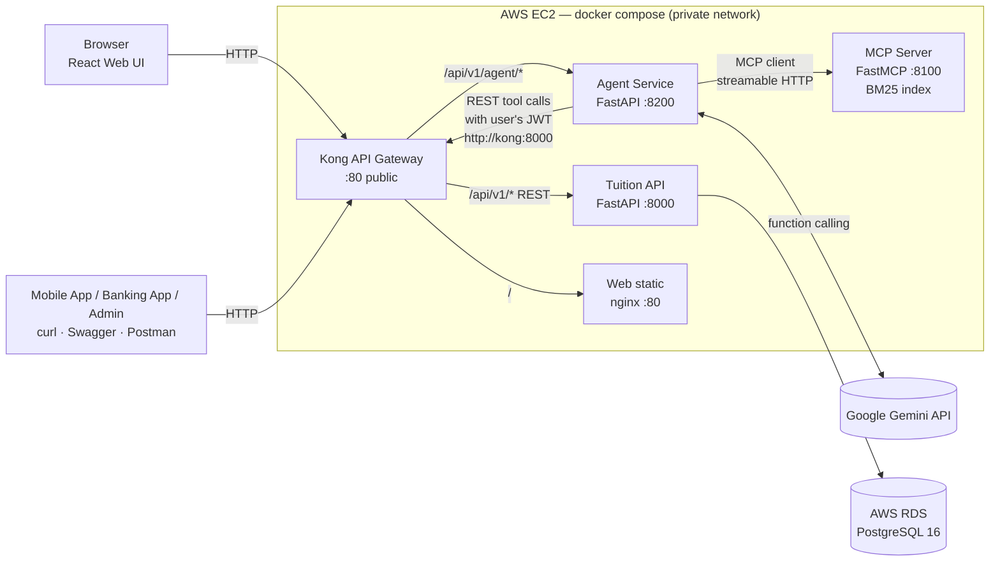
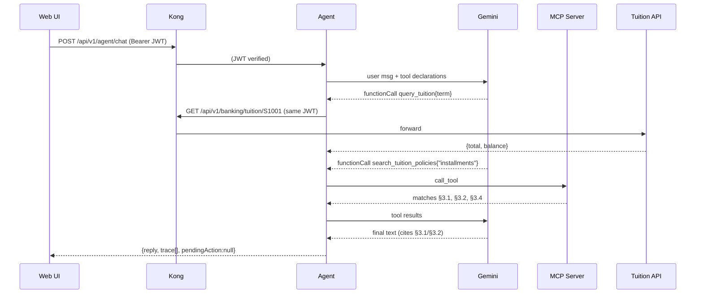
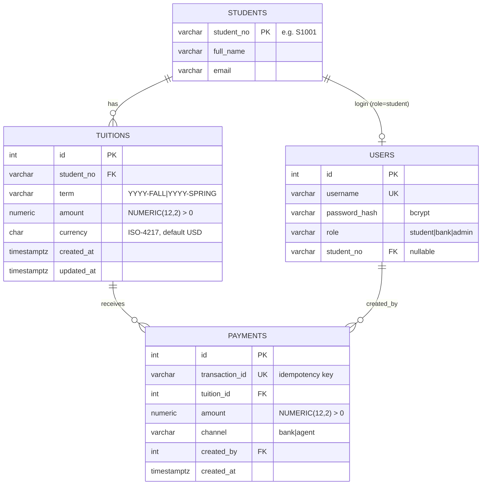

# Technical Design Document
## AI Tuition Assistant

| Field | Value |
|---|---|
| Document ID | TDD-TUITION-01 |
| Version | 1.0 |
| Date | 2026-11-17 |
| Implements | `01_SRS.md` (SRS-TUITION-01) |

This document defines **how** the system is built: the stack, service boundaries, API contract, data model, gateway, MCP, agent and deployment. Code must follow this document. If code needs to diverge, update this document first.

---

## 1. Technology stack

| Concern | Choice | Notes |
|---|---|---|
| Language | Python 3.12 | All backend services. |
| REST framework | FastAPI + Pydantic v2 | Built-in OpenAPI/Swagger. |
| ORM / migrations | SQLAlchemy 2.0 + Alembic | `psycopg` (v3) driver. |
| Database | PostgreSQL 16 | Docker locally; **AWS RDS** in the cloud. |
| Auth | JWT (HS256) issued by the Tuition API; `PyJWT`, `bcrypt` | Verified at the gateway **and** in the service. |
| API Gateway | **Kong Gateway OSS 3.x**, DB-less (declarative `kong.yml`) | See ADR-01. |
| MCP | Official **MCP Python SDK** (`mcp`, `FastMCP`) | Streamable HTTP transport (stdio also available for the Inspector). |
| Search index | BM25 (`rank-bm25`) over section chunks | Full-text search is sufficient for a single policy document. Built once at build time. |
| LLM | **Google Gemini Flash** via the `google-genai` SDK | Free tier. Model set by `GEMINI_MODEL`. |
| Web UI | React 18 + Vite + TypeScript + Tailwind CSS | Designed in Google Stitch → Figma. |
| Tests | pytest, httpx `TestClient`, `testcontainers[postgres]` | No cloud, no live LLM. |
| Packaging | Docker + Docker Compose | Same compose setup locally and on AWS. |
| CI | GitHub Actions | Runs the tests on every push. The run is test evidence. |
| Cloud | AWS: EC2 (compose host) + RDS PostgreSQL | See ADR-02. |

---

## 2. Architecture



**Key rules**
1. **Kong is the only public entry point.** Nothing else publishes a host port in production.
2. The agent calls the REST API **through Kong** (`http://kong:8000`), never through `tuition-api:8000` directly. This makes NFR-01 true for agent traffic as well.
3. The MCP path (agent → MCP server) is **separate** from the gateway path by design.
4. The LLM never calls a backend. It only returns `functionCall`s, and the agent runs them.

### 2.1 Chat turn sequence (combined scenario A3)



---

## 3. Repository layout

```
tuition-assistant/              (git repo root)
├── README.md                   setup, routes, assumptions, demo
├── docker-compose.yml          local: all services + postgres
├── docker-compose.prod.yml     AWS: no postgres (RDS), only Kong publishes a port
├── .env.example
├── docs/                       SRS, design, test plan, ER, screenshots, openapi.json
├── gateway/
│   ├── kong.yml.template       declarative config (envsubst at start)
│   └── Dockerfile
├── services/
│   ├── tuition-api/
│   │   ├── app/ (main.py, config.py, db.py, models.py, schemas.py,
│   │   │         security.py, errors.py, routers/, services/)
│   │   ├── alembic/
│   │   ├── seed/ (seed.py, sample_batch.csv)
│   │   ├── tests/
│   │   ├── requirements.txt
│   │   └── Dockerfile
│   ├── mcp-server/
│   │   ├── app/ (server.py, chunker.py, index.py)
│   │   ├── data/University_Tuition_Policies.md
│   │   ├── scripts/build_index.py   → index/policy_index.json
│   │   ├── tests/
│   │   └── Dockerfile
│   └── agent/
│       ├── app/ (main.py, llm.py, tools.py, mcp_client.py,
│       │         rest_client.py, pending.py, trace.py, prompts.py)
│       ├── tests/ (FakeLLM)
│       └── Dockerfile
├── web/                        React + Vite app, nginx Dockerfile
└── .github/workflows/ci.yml
```

---

## 4. Data model



- Unique constraint: `TUITIONS(student_no, term)`.
- `balance = tuitions.amount − COALESCE(SUM(payments.amount), 0)`. It is computed, not stored, so it cannot drift.
- Pay Tuition runs in one transaction with `SELECT … FOR UPDATE` on the tuition row, so concurrent payments cannot overdraw the balance. The unique `transaction_id` makes duplicate inserts fail, which gives `409`.

### 4.1 Seed data
| Username / password | Role | studentNo | Tuition |
|---|---|---|---|
| `s1001` / `Pass1001!` | student | S1001 | 2026-FALL $3,000 (paid $0), 2027-SPRING $3,000 |
| `s1002` / `Pass1002!` | student | S1002 | 2026-FALL $2,500 (paid $2,500 → balance 0) |
| `s1003` / `Pass1003!` | student | S1003 | 2026-FALL $250 (below the installment threshold) |
| `bank` / `Bank123!` | bank | — | — |
| `admin` / `Admin123!` | admin | — | — |

Plus about 25 extra students without logins, so the unpaid list has more than one page. `seed/sample_batch.csv` contains valid rows and deliberately invalid rows for the batch demo.

---

## 5. REST API contract (v1)

Base (public, through Kong): `http://<GATEWAY_HOST>/api/v1`.
Swagger UI: `/api/v1/docs`. OpenAPI JSON: `/api/v1/openapi.json`. The exported copy is in `docs/openapi.json`.

| # | Method & path | Auth (role) | Request | 2xx response | Errors |
|---|---|---|---|---|---|
| 1 | `POST /auth/login` | — | `{username, password}` | `200 {accessToken, tokenType, expiresIn, role, studentNo}` | 401 |
| 1b | `GET /auth/me` | any valid token | — | `200 {userId, username, role, studentNo}` | 401 |
| 2 | `GET /mobile/tuition/{studentNo}?term=` | none, **3/day/student** | — | `200 TuitionSummary` | 404, 422, **429** (Kong) |
| 3 | `GET /banking/tuition/{studentNo}?term=` | student (self), bank | — | `200 TuitionSummary` | 401, 403, 404 |
| 4 | `POST /banking/payments` | student (self), bank | `{studentNo, term, amount, transactionId}` | `201 {status:"SUCCESS", transactionId, studentNo, term, paidAmount, totalPaid, remainingBalance, currency}` | 401, 403, 404, **409** dup txn, **422** amount ≤0 / > balance |
| 5 | `POST /admin/tuition` | admin | `{studentNo, term, amount, currency}` | `201 {status:"CREATED"}` / `200 {status:"UPDATED"}` | 401, 403, 409 (below paid), 422 |
| 6 | `POST /admin/tuition/batch` | admin | `multipart/form-data file=<csv>` | `200 {status, successCount, failureCount, errors:[{row, studentNo, reason}]}` | 400 bad header/file, 401, 403 |
| 7 | `GET /admin/tuition/unpaid?term=&page=1&pageSize=10` | admin | — | `200 {items:[{studentNo, fullName, tuitionTotal, paid, balance, currency}], page, pageSize, totalItems, totalPages}` | 401, 403, 422 (pageSize 1–100) |

`TuitionSummary`:
```json
{
  "studentNo": "S1001",
  "term": "2026-FALL",              // null when overall
  "tuitionTotal": "3000.00",
  "totalPaid": "500.00",
  "balance": "2500.00",
  "currency": "USD",
  "terms": [ { "term": "2026-FALL", "tuitionTotal": "3000.00", "totalPaid": "500.00", "balance": "2500.00" } ]
}
```
Amounts are serialized as strings, so no float rounding can occur.

Payment errors: student acting for another student → `403 FORBIDDEN_OTHER_STUDENT`; unknown student/term → `404 STUDENT_NOT_FOUND` / `404 TUITION_NOT_FOUND`; reused `transactionId` → `409 DUPLICATE_TRANSACTION` (nothing is applied; `details` carries the original payment so a retrying client can treat it as already done); amount > balance → `422 AMOUNT_EXCEEDS_BALANCE` (`details.balance`); amount ≤ 0 or more than 2 decimals → `422 VALIDATION_ERROR`. `channel` is recorded as `agent` for student tokens and `bank` for bank tokens.

Admin rules: Add Tuition needs an existing student (`404 STUDENT_NOT_FOUND`; students are not created implicitly). The same `(studentNo, term)` updates the record (`200 UPDATED`, response includes `previousAmount`); an update below the amount already paid → `409 AMOUNT_BELOW_PAID`; changing the currency after payments → `409 CURRENCY_CHANGE_NOT_ALLOWED`. Batch: header must be exactly `studentNo,term,amount,currency` (`400 INVALID_CSV_HEADER`); empty, binary, non-UTF-8 or >1 MB files → `400`; at most 5,000 rows. Each row is validated and applied in its own savepoint, so one bad row never rolls back the others. The response is `{status: COMPLETED|PARTIAL|FAILED, totalRows, successCount, failureCount, createdCount, updatedCount, errors:[{row, studentNo, code, reason}]}`, where `row` is the line number in the file (header = line 1). Unpaid list: `term` is required; items are ordered by `studentNo`; a page past the end returns `items: []`.

Query errors: unknown student → `404 STUDENT_NOT_FOUND`; a `term` the student has no tuition for → `404 TUITION_NOT_FOUND`; malformed `term` → `422 VALIDATION_ERROR`. Terms are listed chronologically (`2026-FALL` before `2027-SPRING`). Amounts in different currencies are never added together: an overall query over mixed currencies returns `409 MIXED_CURRENCIES` (query one term instead).

**Error body (service)**: `{"error": {"code": "DUPLICATE_TRANSACTION", "message": "...", "details": {...}}}`.
**Error body (gateway)**: Kong's native `{"message": "API rate limit exceeded"}` / `{"message": "Unauthorized"}`. This is the documented sample gateway error.

**Versioning**: the major version is in the URL path. FastAPI routers are mounted under `/api/v1`. A `v2` would be a new router module plus a new Kong route; `v1` stays untouched.

---

## 6. Authentication & authorization

1. `POST /auth/login` checks the bcrypt hash (an unknown username and a wrong password return the same `401 INVALID_CREDENTIALS`, so usernames cannot be probed) and returns a JWT: `{iss:"tuition-auth", sub, role, studentNo, iat, exp(+60m)}`, signed HS256 with `JWT_SECRET`.
2. **Kong** `jwt` plugin on the protected routes: it verifies the signature and `exp`. The consumer `tuition-auth` holds the same secret. An invalid or missing token gets `401` at the edge, before reaching the service.
3. **Service** (defense in depth): it verifies the JWT again, then authorizes:
   - `/banking/*`: role `bank` → any student; role `student` → only `token.studentNo == path/body studentNo`, otherwise `403 FORBIDDEN_OTHER_STUDENT`.
   - `/admin/*`: role `admin` only.
   - Token errors: missing → `401 UNAUTHORIZED`, expired → `401 TOKEN_EXPIRED`, bad signature/issuer/claims → `401 INVALID_TOKEN`. Wrong role → `403 FORBIDDEN_ROLE`.
4. **Agent**: it reads the user's `Authorization` header (Kong passes it through) and reuses it for its REST tool calls. It holds **no** service account, so a prompt such as "show S1002's balance" ends in a `403`, and the LLM is told to refuse.

---

## 7. API Gateway (Kong) design

DB-less `kong.yml.template`. At container start, `envsubst` injects `JWT_SECRET` and the upstream hosts. Proxy port `8000` is mapped to host `:80`. The Admin API is **not** exposed.

| Kong route (public) | Upstream | Plugins |
|---|---|---|
| `POST /api/v1/auth/login` | tuition-api | rate-limiting (IP, 20/min) |
| `GET ~/api/v1/mobile/tuition/(?<studentNo>[A-Za-z0-9]+)$` | tuition-api | **pre-function** (copies the captured `studentNo` into header `X-RateLimit-Student`) → **rate-limiting** `day: 3, limit_by: header, header_name: X-RateLimit-Student` |
| `/api/v1/banking/*` | tuition-api | **jwt** |
| `/api/v1/admin/*` | tuition-api | **jwt** |
| `/api/v1/agent/*` | agent | **jwt**, rate-limiting (consumer, 30/min) |
| `/api/v1/docs`, `/api/v1/openapi.json` | tuition-api | — |
| `/` | web | — |

- Global plugins: `correlation-id` (an `X-Request-ID` header that also appears in the agent tool trace) and `file-log` to stdout.
- **Per-student limit (FR-02)**: the counter key is the student number taken from the path, so 3 different IPs asking for S1001 still share one counter, while S1001 and S1002 have separate counters. The pre-function overwrites any `X-RateLimit-Student` header sent by the client, so the key cannot be spoofed.
- Backend protection: the services sit on the private compose network, and only Kong publishes a port.

---

## 8. MCP server design

**Chunking** (`chunker.py`): parse the markdown and create one chunk per `###` section (`2.1`, `3.2`, …). A `##` section without subsections (e.g. `1. Scope`) becomes one chunk of its own. Each chunk has the fields `{id, section, heading, parent_heading, text, document, documentId}`.

**Indexing** (`scripts/build_index.py`): run at Docker build time. It tokenizes the text (lowercase, strips punctuation and English stopwords, applies a light suffix stemmer, and repeats the heading tokens 2× for boost), then writes `index/policy_index.json`. At startup the server loads this file into `BM25Okapi` **once**. There is no per-query re-indexing (FR-21).

**Tool**:
```python
@mcp.tool()
def search_tuition_policies(query: str, top_k: int = 3) -> dict:
    """Search the University Tuition Policies (UNI-TUITION-2026-01) for
    deadlines, installments, late fees, scholarships, refunds, banking/payment rules.
    Returns excerpts with section references. Not a source of student balances."""
```
Returns `{document, documentId, matches:[{section, heading, text, score}]}`. Matches with score 0 are dropped.

**Transport**: streamable HTTP at `http://mcp-server:8100/mcp` (internal only). `python -m app.server --stdio` runs it for **MCP Inspector** screenshots of the 3 retrieval tests (FR-24).

---

## 9. Agent design

**Endpoints** (behind Kong, JWT required):
- `POST /api/v1/agent/chat` `{sessionId, message}` → `{reply, trace[], pendingAction|null}`
- `POST /api/v1/agent/confirm` `{sessionId, actionId, decision:"confirm"|"cancel"}` → `{reply, trace[]}`

**Tools declared to Gemini**:
| Tool | Executes via | Params |
|---|---|---|
| `search_tuition_policies` | MCP client (`list_tools` at startup; the schema comes from the server) | `query`, `top_k?` |
| `query_tuition` | REST → Kong → `GET /banking/tuition/{studentNo}` | `term?`, `studentNo?` (defaults to the token's own) |
| `pay_tuition` | **pending action only** | `term`, `amount` |

**Loop** (`llm.py`): send the history and tools. While the response contains `functionCall`s (at most 5 rounds): execute each one, append a `functionResponse`, and record a trace entry `{step, tool, input, output(truncated), durationMs}`. Then return the final text. Automatic function calling in the SDK is **disabled**, so the agent controls every call.

**Payment confirmation (FR-33)**: `pay_tuition` → the agent calls `query_tuition` for the current balance, generates `transactionId = uuid4`, stores `PendingAction{id, studentNo, term, amount, balance, transactionId, expiresAt(+5m)}` in the session, and returns it to the LLM as `{status:"AWAITING_USER_CONFIRMATION"}`. The UI shows a confirmation card. Only `POST /confirm` with `decision=confirm` calls `POST /banking/payments`, and it reuses the **same** `transactionId`, so a retry cannot double-charge. The rule is enforced in code, not only in the prompt.

**System prompt (key rules)**: use the tools and do not guess; policy questions go to MCP; live data goes to REST; cite `§section`; never state a payment as done without API success; a refusal (403) must not reveal other students' data; a partial payment is not installment approval.

**State**: sessions and pending actions are kept in memory (a single agent instance; documented as an assumption, with Redis as the scale-out path).

**Cost control**: Gemini free tier, a temperature around 0.2, at most 5 tool rounds and history capped at the last 20 messages. Tests use `FakeLLM`.

---

## 10. Web UI

Pages: **Login**, **Chat** (messages, a collapsible **Tool Trace** panel per turn, a **Confirm Payment** card), and **Admin** (add tuition form, CSV upload with result table, unpaid list with paging). The JWT is kept in memory/sessionStorage. Design flow: screens are drafted in Google Stitch, refined in Figma, then implemented in React + Tailwind using the Figma colors and spacing.

---

## 11. Deployment (AWS)

| Resource | Spec | Notes |
|---|---|---|
| EC2 | `t3.small`, Amazon Linux 2023, 20 GB gp3, Elastic IP | Docker + compose plugin. Security group: 80 from anywhere, 22 from the operator's IP only. |
| RDS | PostgreSQL 16, `db.t4g.micro`, 20 GB, single-AZ, **not public** | SG allows 5432 only from the EC2 SG. |
| Secrets | `.env` on EC2 (chmod 600) | `DATABASE_URL`, `JWT_SECRET`, `GEMINI_API_KEY`. Never committed. |
| Budget | AWS Budgets alarm at $10 | Stop/terminate resources when the demo period ends. |

Deploy: `git clone` → `cp .env.example .env` (fill values) → `docker compose -f docker-compose.prod.yml up -d --build` → `alembic upgrade head` + `python -m seed.seed` (one-off container) → smoke test through `http://<EIP>/api/v1/...`.

**Fallback** (if no AWS account): run the same `docker-compose.yml` locally. The README documents this as a deviation.

**Estimated cost**: EC2 t3.small ≈ $0.021/h, RDS t4g.micro ≈ $0.016/h and a public IPv4 ≈ $0.005/h, so about **$1/day**, covered by AWS free-plan credits. Gemini: $0 on the free tier.

---

## 12. Architecture decision records

| ADR | Decision | Reason | Rejected alternative |
|---|---|---|---|
| 01 | **Kong OSS** as the gateway | Native per-header daily rate limiting (per-student key), a JWT plugin, and the same config locally and on AWS. Fast to set up and runs identically in local and cloud environments. | AWS API Gateway: its usage plans are keyed by API key, so a per-student unauthenticated limit would need a Lambda authorizer + DynamoDB. |
| 02 | **EC2 + compose + RDS** | One reproducible deploy command, and a managed server DB satisfies NFR-06. | ECS/Fargate: more IaC and VPC work than the time allows. |
| 03 | **Self-issued JWT** | Simple, testable offline, and the gateway can verify it. | Cognito: login UX and setup time. Documented as the production path. |
| 04 | **BM25 full-text** | Sufficient for one document, it is deterministic and testable, and it needs no embedding cost. | Vector search: optional, extra cost and complexity. |
| 05 | **Pending-action confirmation in code** | Consent cannot be bypassed through a prompt. | Prompt-only confirmation: unreliable. |
| 06 | **Amounts as strings/Decimal** | No float rounding errors on money. | float. |
